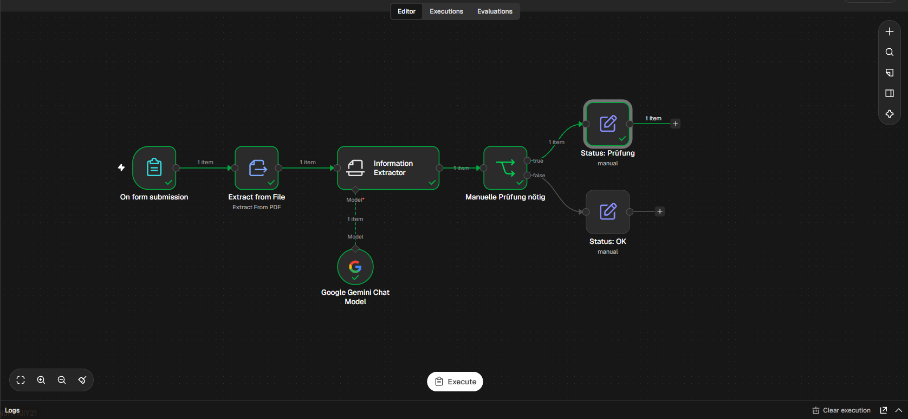

# Belegeingang mit KI – n8n-Workflow

*[English version](README.md)*

Automatisierter Belegeingang für Steuerkanzleien und Unternehmen: Eine PDF-Rechnung wird hochgeladen, eine KI liest die wichtigsten Daten aus, und Prüfregeln aus der Buchhaltungspraxis entscheiden, ob ein Mensch den Beleg zusätzlich prüfen muss – mit Begründung.



## Ziel

In vielen Kanzleien wird jede Rechnung manuell erfasst und geprüft. Der Workflow übernimmt die Routine: **Alle Belege werden automatisch ausgelesen und geprüft, nur die Ausnahmen landen beim Menschen.**

## Ablauf

| Schritt | Node | Funktion |
|---|---|---|
| 1 | **Form Trigger** | Upload-Formular für PDF-Rechnungen |
| 2 | **Extract from File** | Text aus der PDF auslesen |
| 3 | **Information Extractor** + Google Gemini | KI strukturiert die Daten: Lieferant, Rechnungsnummer, Datum, Netto, MwSt, Brutto (inkl. Umwandlung des deutschen Zahlenformats, z. B. „1.441,91 €“ → 1441.91) |
| 4 | **If: Manuelle Prüfung nötig?** | Prüfregeln anwenden |
| 5 | **Status: OK** / **Status: Prüfung** | Beleg markieren, bei Prüfung mit Begründung |

## Prüfregeln

Ein Beleg geht in die manuelle Prüfung, wenn mindestens eine Regel greift:

| Regel | Hintergrund |
|---|---|
| Bruttobetrag über 1.000 € | Freigabegrenze (Vier-Augen-Prinzip), pro Mandant anpassbar |
| Lieferant fehlt | Name des Leistenden ist auf jeder Rechnung Pflicht |
| Rechnungsnummer fehlt **und** Betrag über 250 € | Bei Kleinbetragsrechnungen bis 250 € brutto ist keine Rechnungsnummer erforderlich |

Die Begründung wird automatisch im Feld `grund` gespeichert, z. B. *„Lieferant fehlt“*.

## Testfälle

| Beleg | Erwartet | Ergebnis |
|---|---|---|
| Reinigung, 240 €, vollständig | OK | ✅ |
| Elektriker, 1.441,91 € | Prüfung – Betrag über 1.000 € | ✅ |
| Reparatur, 89 €, ohne Lieferant und Nummer | Prüfung – Lieferant fehlt | ✅ |
| Schlüsseldienst-Quittung, 180 €, ohne Nummer | OK (Kleinbetragsrechnung) | ✅ |

Beobachtungen aus den Tests:
- Fehlende Angaben werden von der KI **leer gelassen und nicht erfunden**.
- Bei einer Quittung ohne Aufteilung hat die KI Netto und MwSt **selbst berechnet** (korrekt). In der Praxis sollten berechnete Werte gekennzeichnet werden.

## Datenschutz & Sicherheit

- **Selbst gehostet** (Docker) – Belegdaten verlassen die eigene Infrastruktur nur für den KI-Aufruf.
- **Zugangsdaten** liegen in den n8n-Credentials, **nicht** im Workflow. Der Export enthält keinen API-Key.
- Das KI-Modell ist austauschbar (z. B. Gemini, Claude oder ein lokales Modell), ohne die Logik zu ändern.

## Installation

```bash
docker run -it --rm --name n8n -p 5678:5678 -v n8n_data:/home/node/.n8n docker.n8n.io/n8nio/n8n
```

1. `http://localhost:5678` öffnen
2. Workflow importieren: **Import from File** → `belegeingang-workflow.json`
3. Im Node *Google Gemini Chat Model* eigene Zugangsdaten hinterlegen
4. **Execute workflow** → PDF-Rechnung hochladen

## Ausblick

- Gmail-Trigger statt Formular (Rechnungen direkt aus dem Posteingang)
- Ablage der Ergebnisse in einer Tabelle oder Übergabe an DATEV Unternehmen online
- Prüfregeln (Freigabegrenze) pro Mandant konfigurierbar machen
- Kennzeichnung berechneter Werte

---
Marcela-Maria Skrbin · [LinkedIn](https://www.linkedin.com/in/marcela-maria-skrbin-0b8ba8108)
