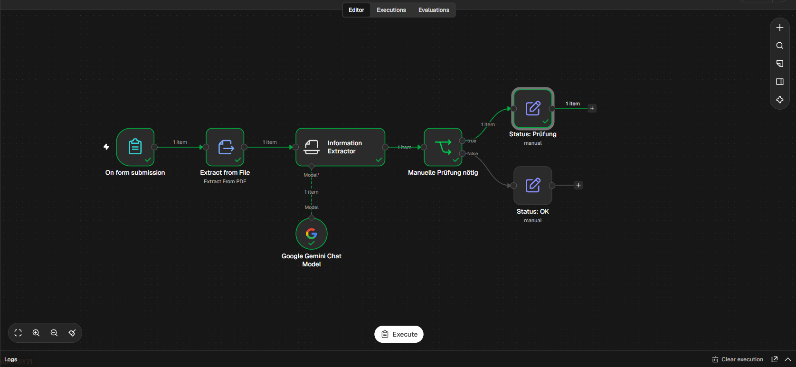

# AI-Powered Invoice Intake – n8n Workflow

*[Deutsche Version](README.de.md)*

Automated document intake for accounting and tax firms: a PDF invoice is uploaded, an AI model extracts the key data, and validation rules taken from real bookkeeping practice decide whether a human needs to review the document – with a stated reason.



## Goal

In many accounting firms, every invoice is still captured and checked by hand. This workflow takes over the routine: **every document is extracted and checked automatically, and only the exceptions reach a human.**

## How it works

| Step | Node | Purpose |
|---|---|---|
| 1 | **Form Trigger** | Upload form for PDF invoices |
| 2 | **Extract from File** | Extract the text from the PDF |
| 3 | **Information Extractor** + Google Gemini | AI structures the data: supplier, invoice number, date, net, VAT, gross (including conversion of the German number format, e.g. "1.441,91 €" → 1441.91) |
| 4 | **If: Manual review needed?** | Apply the validation rules |
| 5 | **Status: OK** / **Status: Review** | Flag the document, with a reason when review is needed |

## Validation rules

A document goes to manual review if at least one rule applies:

| Rule | Rationale |
|---|---|
| Gross amount above €1,000 | Approval threshold (four-eyes principle), configurable per client |
| Supplier missing | The supplier's name is mandatory on every invoice |
| Invoice number missing **and** amount above €250 | Under German VAT rules, small-value invoices up to €250 gross (*Kleinbetragsrechnung*) do not require an invoice number |
| Tax number / VAT ID or date of supply missing (above €250) | Mandatory invoice details under § 14 UStG; small-amount invoices up to €250 are exempt (§ 33 UStDV) |

The reason is written automatically to the `grund` field, e.g. *"Lieferant fehlt"* (supplier missing).

## Test cases

| Document | Expected | Result |
|---|---|---|
| Cleaning service, €240, complete | OK | ✅ |
| Electrician, €1,441.91 | Review – amount above €1,000 | ✅ |
| Repair, €89, no supplier or number | Review – supplier missing | ✅ |
| Locksmith receipt, €180, no number | OK (small-value invoice) | ✅ |

Findings from testing:
- Missing fields are **left empty by the AI, not invented**.
- For a receipt without a net/VAT breakdown, the AI **calculated** net and VAT itself (correctly). In production, calculated values should be flagged as such.

## Privacy & security

- **Self-hosted** (Docker) – document data only leaves your own infrastructure for the AI call.
- **Credentials** are stored in n8n's credential store, **not** in the workflow. The exported JSON contains no API key.
- The AI model is interchangeable (e.g. Gemini, Claude or a local model) without changing the logic.

## Setup

```bash
docker run -it --rm --name n8n -p 5678:5678 -v n8n_data:/home/node/.n8n docker.n8n.io/n8nio/n8n
```

1. Open `http://localhost:5678`
2. Import the workflow: **Import from File** → `belegeingang-workflow.json`
3. Add your own credentials in the *Google Gemini Chat Model* node
4. **Execute workflow** → upload a PDF invoice

## Next steps

- Gmail trigger instead of the form (invoices straight from the inbox)
- Write results to a spreadsheet or hand them over to DATEV Unternehmen online
- Make the approval threshold configurable per client
- Flag calculated values

---
Marcela-Maria Skrbin · [LinkedIn](https://www.linkedin.com/in/marcela-maria-skrbin-0b8ba8108)
